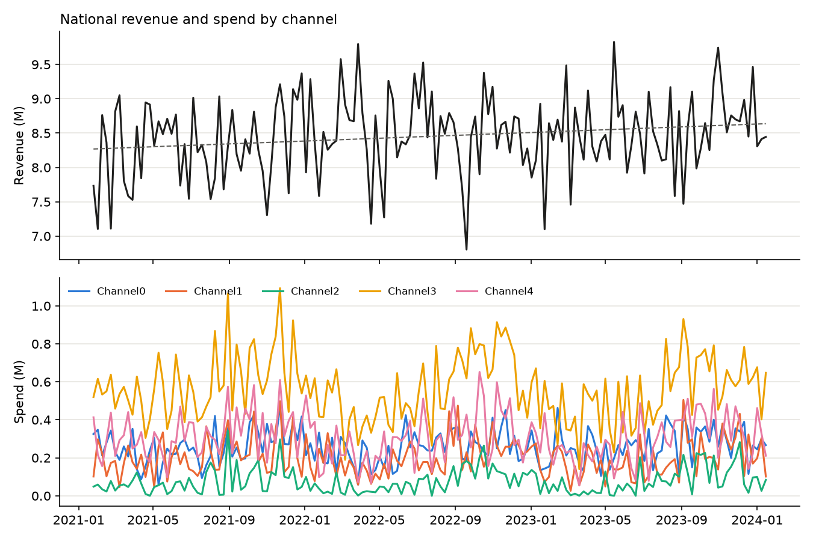

# Geo-level Bayesian MMM: Meridian simulated data

A Bayesian marketing mix model of Google Meridian's simulated geo dataset
([`geo_all_channels.csv`](https://github.com/google/meridian/blob/main/meridian/data/simulated_data/csv/geo_all_channels.csv)),
built with [PyMC-Marketing](https://github.com/pymc-labs/pymc-marketing) 1.3. It estimates channel contribution and
ROI with uncertainty. Automated pass/fail gates decide whether a fit is acceptable, so no one has to judge it by
looking at plots.

## Verdict: is this good enough for a client?

**Yes, with the caveats below.** The model is fit to inform channel and budget decisions. The automated gates
return **PASS_WITH_WARNINGS** (41 pass, 4 warn, 0 fail; evidence in
[`reports/diagnostics.md`](reports/diagnostics.md) and [`outputs/gate_report.md`](outputs/gate_report.md)).

**Why it can be shown.** The selected model (`hier_media`):
- converges cleanly (R-hat ≤ 1.006, ESS ≥ 532, no divergences);
- has calibrated geo-week predictive intervals;
- forecasts four held-out quarters without degrading (national weekly error 3.5–7.0%);
- gives channel ROI that stays within 1.6× across those training windows;
- learns ROI from the data: posteriors are far narrower than priors.

**What a client can be told** ([`reports/measurement.md`](reports/measurement.md)):
- **Channel2 and Channel3 pay back clearly:** ROI 2.12 and 1.67, P(ROI > 1) of 1.00 and 0.99.
- **Channel1 and Channel0 likely do not** (ROI 0.69 and 0.79, P = 0.14 and 0.25). **Channel4 is around
  break-even** (1.10, P = 0.71). The gates mark all three as undetermined.
- **A budget-neutral shift of up to ±20% per channel**, from Channel0, Channel1 and Channel4 into Channel2 and
  Channel3, gains an estimated **+3.6M revenue over 52 weeks** (94% HDI +0.8M to +7.1M; P(gain > 0) = 0.98),
  about 0.8% of revenue.
- **A shift of up to ±50%** has a larger expected gain, **+7.2M** (94% HDI −0.2M to +16.0M; P(gain > 0) = 0.96).
  The wider range is the model's honest statement of how much is at stake; the business weighs it against its
  appetite for risk.

**Caveats that must go with the numbers:**
- **Control effects are shared across geos,** although the competitor and sentiment effects vary by geo
  (I² 0.94, 0.88) and correlate with spend; some of that can leak into media ROI.
- **Baseline and media trade off** (posterior correlation −0.93): channel rankings are firmer than absolute
  contributions.
- **National forecast intervals are too narrow out-of-sample** (69–92% coverage for a 94% interval), because
  baseline level shifts are not in the model.
- **Intervals beyond observed spend assume the logistic response-curve shape.** They include uncertainty about
  every parameter but not about the curve's form, so the ±50% interval is, if anything, optimistic about its own
  width.

**What would make it fully client-ready:** lift tests on the large undetermined budgets (Channel4, 21.7% of
spend; Channel0, 18.5%), calibrated into the model, and the next-step model fixes below.

## Reproduce

**One command** (needs `uv`; about 3 hours on an 8-core laptop, mostly MCMC):

```bash
make all
```

**Or in Docker** (no local Python needed; writes `outputs/` and `reports/` into the working copy):

```bash
make docker      # = docker build -t mmm-geo . && docker run --rm -v $PWD/outputs:/app/outputs -v $PWD/reports:/app/reports mmm-geo
```

`make all` runs these steps in order; each can also be run on its own:

```bash
make setup     # fetch + checksum the data, create .venv from requirements.lock
make eda       # exploratory analysis -> outputs/eda/ (summary JSON + figures)
make fit-all   # fit the candidate specifications
make select    # pick the specification by the protocol -> outputs/model_selection.md
make holdout   # refit the selected spec without the last 13 weeks and score the forecast
make cv        # rolling-origin CV folds for the selected spec (train to week 104/117/130, forecast 13)
make calibrate # refit the selected spec with the hypothetical lift test
make gates     # automated acceptance checks; exits 1 if any blocking check fails
make results   # outputs/channel_results.csv + metadata
make reports   # reports/diagnostics.md (model health) and reports/measurement.md (results, scenario, calibration)
```

Everything in `outputs/` and `reports/` is a deterministic function of `config/pipeline.yaml`, the checksummed data
and `requirements.lock`. MCMC is seeded.

## Data

- 40 geos × 156 weeks (2021-01-25 to 2024-01-15): a balanced panel with no missing values.
- 5 paid channels, each with spend and impressions. Spend is exactly impressions × a constant CPM per channel,
  so modeling spend loses no information.
- Controls: competitor sales, sentiment, promo and organic impressions.
- KPI: conversions. `revenue_per_conversion` is effectively constant (0.02, CV 0.5%), so revenue is
  conversions × 0.02.

## Exploratory analysis

`make eda` writes
[`outputs/eda/eda_summary.json`](outputs/eda/eda_summary.json) plus figures. Every finding below comes from the
raw data; no model was used.

| Question | Finding | Bearing on the model |
|---|---|---|
| Enough data? | 156 weeks × 40 geos, balanced, no gaps | About 3 years of weekly data per geo: enough to estimate carryover and saturation |
| Trend? | National revenue +4.4% over 3 years; HAC t = 2.6, p = 0.01 | Keep a linear trend control |
| Yearly seasonality? | Week-of-year means explain 36% of detrended national variance, vs 33% expected from pure noise (95th percentile 42%); lag-52 autocorrelation 0.06 | No detectable seasonality: no Fourier terms |
| Noise | Within-geo weekly CV 0.30, lag-1 autocorrelation 0.02 | Revenue is close to white noise around each geo's level; accuracy gates are set against this floor |
| Channel–revenue signal | Within-geo correlation of spend with revenue −0.08 to +0.03; lagged 1–8 weeks, at most 0.04 | Weak timing signal and no visible carryover beyond 1–2 weeks: short adstock |
| Channel collinearity | Within-geo correlations 0.17–0.50; VIF ≤ 1.6 (national ≤ 2.4) | Channels are separable |
| Geo size | Revenue r = 0.97 and spend r = 0.997 with population; spend per capita CV 3.6%; channel mix nearly identical across geos | Normalize each geo's scale. Between-geo totals carry no media information: it all comes from spend timing within geos (cross-geo timing correlation 0.18–0.33) |
| Saturation range | Median geo-week spend is 18–40% of that geo's max; 90th percentile 58–70%; Channel2 is zero in 64% of geo-weeks | The top of each response curve is sparsely observed, so the saturation prior matters |
| Controls | Competitor sales (r = −0.20) and promo (+0.13) relate to revenue within geo; competitor, sentiment and organic correlate 0.41–0.55 with spend | Controls are confounders and must be modeled carefully: errors there leak into media estimates |
| Do control effects differ by geo? | Per-geo regressions of relative revenue on the controls (holding spend fixed): competitor sales I² = 0.94, sentiment I² = 0.88 (both p < 0.001); promo, organic and trend I² 0.20–0.24, not significant | Competitor and sentiment effects vary by geo far more than noise explains |



## Candidate specifications

### Choices shared by all candidates, and the EDA evidence for them

| Choice | Setting | Why |
|---|---|---|
| Target | Revenue (conversions × revenue_per_conversion) | ROI is then incremental revenue per unit of spend |
| Media input | Spend | Exactly proportional to impressions |
| Scaling | Channels and target scaled by **geo population** (pymc-marketing `FixedScaling`: population × the largest per-capita value), so the model works in per-capita terms. Contributions and ROI are still reported in revenue | Revenue and spend are proportional to population (r = 0.97, 0.997). Population is fixed and independent of the noisy weekly data, unlike a per-geo maximum. Shared effects then mean "same per-capita effect in every geo" |
| Controls | Competitor sales, sentiment, promo, organic impressions, linear trend | Confounders of spend, and a significant trend |
| Seasonality | None | Not detectable above chance |
| Adstock | Geometric, `l_max` 4 weeks, α ~ Beta(1, 3) | No lagged signal beyond 1–2 weeks |
| Saturation | Logistic, λ ~ Gamma(3, 1) | Standard for spend scaled to [0, 1] |
| Effect size anchor | Spend share × an assumed 30% media share of revenue, in the model's per-capita scaled units; prior SD 2× the anchor | Channel mix is nearly identical across geos, so national spend shares are a fair anchor |
| Baseline and noise | One intercept per geo; one noise SD per geo | Geo levels differ, and per-geo noise is cheap |

### The candidates

| Candidate | Media effect size | Control effects | Rationale |
|---|---|---|---|
| **A. `pooled_media`** | One per channel, shared by all geos | Shared by all geos | Simplest. Channel mix and spend intensity are nearly identical across geos, so a common relative response is plausible |
| **B. `hier_media`** | Partially pooled across geos (non-centered log-normal) | Shared by all geos | Meridian's default for geo models. Spend timing differs across geos, which can inform geo-level differences |
| **C. `hier_media_controls`** | Partially pooled across geos | Partially pooled across geos (non-centered normal, one spread per control) | The controls are confounders (r up to 0.55 with spend), and the competitor and sentiment effects vary by geo (I² 0.94, 0.88). Forcing one value pushes that variation into the residuals and partly into media. Controls without heterogeneity shrink toward a shared value |

### Selection protocol (fixed before fitting)

1. **Fit all three** on the full data: 4 chains × 1000 draws, 1000 tuning steps, `target_accept` 0.95.
2. **Convergence.** A fit that fails R-hat, ESS, divergence or E-BFMI checks stops without results, and the
   candidate is dropped. There are no reruns with more draws.
3. **Select** among converged candidates by PSIS-LOO (`az.compare`, with pointwise log-likelihoods saved). The
   highest ELPD wins, unless a simpler candidate (A < B < C) is within 2 standard errors of the difference, in
   which case the simpler one wins.
4. **Validate the selected spec:** 13-week holdout and three rolling-origin CV folds.
5. **Gates decide** on the selected spec, its holdout and its CV folds.

### Selection result

Only `hier_media` (B) converged; `pooled_media` (A) and `hier_media_controls` (C) failed their convergence checks
and were dropped without results ([`outputs/model_selection.md`](outputs/model_selection.md)). B was therefore
selected by convergence, not by an ELPD comparison.

## Results

**Diagnostics.** Clean convergence, calibrated geo-week intervals, and stable forecasts and ROI across four
rolling-origin folds. Weak spots: national intervals are too narrow out-of-sample, and baseline and media trade off.
Details: [`reports/diagnostics.md`](reports/diagnostics.md).

**Measurement.** Media drives about 21% of revenue. Channel2 (ROI 2.12) and Channel3 (1.67) pay back clearly;
Channel0 (0.79) and Channel1 (0.69) likely do not; Channel4 (1.10) is around break-even. Channel3 contributes the
most revenue. Details: [`reports/measurement.md`](reports/measurement.md).

**Budget recommendations** (budget-neutral, last 52 weeks): move spend from Channel0, Channel1 and Channel4 into
Channel2 and Channel3. At ±20% per channel that gains **+3.6M** revenue (94% HDI +0.8M to +7.1M); at ±50%,
**+7.2M** (−0.2M to +16.0M). Lift tests on Channel4 and Channel0 would firm up the picture.
Details: [`reports/measurement.md`](reports/measurement.md), section 4.

| Report | Contents |
|---|---|
| [`reports/diagnostics.md`](reports/diagnostics.md) | Model health: data and prior checks, convergence (R-hat, ESS, rank plots, energy), in-sample fit and residuals, holdout and rolling-origin CV, ROI identification, limitations |
| [`reports/measurement.md`](reports/measurement.md) | Channel ROI, marginal ROI and contribution with credible intervals; revenue decomposition; response curves; budget reallocation scenarios; calibration with a hypothetical lift test |
| [`outputs/channel_results.csv`](outputs/channel_results.csv) | One row per channel for downstream use; column definitions in `outputs/channel_results_metadata.json` |
| [`outputs/budget_scenario.csv`](outputs/budget_scenario.csv) | Main reallocation scenario per channel; both scenarios in `budget_scenario.json` |


## Automated acceptance gates

`src/mmm/gates.py` reads each fit's `metrics.json` and marks every check PASS, WARN or FAIL. Any FAIL on the
selected spec makes `make gates` exit with code 1, so CI can refuse to publish the results. Thresholds live in
`config/pipeline.yaml`.

| Group | Check | Threshold | On failure |
|---|---|---|---|
| Data | Required columns, balanced weekly panel, no missing values, no negative spend or KPI | exact | FAIL |
| Priors | Share of observations inside the 94% prior predictive interval | 50–100% | FAIL |
| Convergence | R-hat max over all parameters | ≤ 1.01 | FAIL; run stops without results |
| | Bulk and tail ESS min | ≥ 400 | FAIL; run stops without results |
| | Divergences | 0 | FAIL; run stops without results |
| | E-BFMI min | ≥ 0.3 | FAIL; run stops without results |
| Fit | In-sample R² | ≥ 0.60 | FAIL |
| | 94% posterior predictive interval coverage | 85–99% | FAIL |
| | Within-geo R² (signal strength) | ≥ 0.20 | WARN |
| | Residual lag-1 autocorrelation (median across geos) | ≤ 0.30 | WARN |
| | PSIS-LOO share of observations with Pareto k > 0.7 | ≤ 1% | WARN |
| Holdout | Holdout geo-week MAPE ÷ in-sample MAPE | ≤ 1.25 | FAIL |
| | National weekly MAPE on the holdout | ≤ 10% | FAIL |
| | 94% interval coverage on the holdout | ≥ 80% | FAIL |
| ROI | Posterior SD of ROI much smaller than prior SD (contraction ≥ 0.3) | per channel | WARN |
| | P(ROI > 1) ≥ 0.9 or ≤ 0.1: clearly above or below break-even | per channel | WARN |
| Rolling-origin CV | Each fold: the three holdout checks | as holdout | FAIL |
| | Max ÷ min median ROI across the folds and the full fit | > 2 WARN, > 5 FAIL | FAIL |

**Accuracy thresholds are set against the noise floor.** Weekly revenue within a geo is close to white noise
around the geo's level (CV 0.30, lag-1 autocorrelation 0.02), so absolute geo-week accuracy thresholds would fail
any model. Instead: the holdout must not be worse than in-sample, the national total (where geo noise averages
out) must be accurate, and predictive intervals must be calibrated.

## What the data can't support

From the EDA alone:
- **Weak signal at the geo-week level.** Spend timing barely correlates with revenue within geos, and differences
  between geos only reflect size. Channel ROIs will be wide.
- **Baseline and media are hard to separate** without experiments.
- **Saturation is weakly identified.** The top of each response curve is rarely observed.
- **Channel2 is often dark** (zero spend in 64% of geo-weeks).
- **No ground truth in the CSV.** The data is simulated, but the true ROIs are not published alongside it.

## Next steps

1. **Real lift tests** (geo holdouts) on Channel4 and Channel0, the largest budgets with undetermined payback.
   The calibration machinery is in place and demonstrated with a hypothetical test (`make calibrate`); a real
   result goes into the same file format (`geo, channel, x, delta_x, delta_y, sigma`). Tests are also the only fix
   for the baseline–media trade-off.
2. **Geo-varying effects for competitor sales and sentiment only.** The EDA shows these two control effects vary
   by geo (I² 0.94 and 0.88), while promo, organic and trend do not. Both are confounders of spend, so sharing
   them across geos can bias media ROI. pymc-marketing's `ControlMuEffect` can add them as a separate term with a
   geo-varying (partially pooled) coefficient, leaving the other controls as one shared effect each. The model
   input then has to be an `xr.Dataset` carrying those columns, for fitting and for out-of-sample prediction.
3. **A time-varying baseline** (e.g. a Gaussian-process intercept) so national forecast intervals include level
   shifts.
4. **Prior calibration.** The prior predictive allows negative revenue and is far wider than the data. Tighter
   intercept and noise priors would keep the model honest without changing the media priors. Channel2's posterior
   ROI also extends past its spend-share prior, so that prior may be shrinking small channels.
5. **Pre-declared sensitivity runs** for the saturation prior and the 30% media-share anchor, reported whatever
   they show.

## Repository layout

```
config/pipeline.yaml          data mapping, candidate specs, sampler, gate thresholds
src/mmm/data.py               load, validate, shape the panel (incl. population)
src/mmm/eda.py                exploratory analysis -> outputs/eda/
src/mmm/model.py              build a PyMC-Marketing MMM from a spec (population scaling)
src/mmm/run_spec.py           fit one spec; stop if not converged; fit, holdout, ROI -> outputs/specs/<run>/
src/mmm/select.py             candidate selection by PSIS-LOO -> outputs/model_selection.md
src/mmm/gates.py              automated acceptance -> outputs/gate_report.{json,md}
src/mmm/results.py            channel results file
src/mmm/fitted.py             rebuild a fitted model from its saved posterior
src/mmm/report_diagnostics.py model health report -> reports/diagnostics.md
src/mmm/report_measurement.py measurement report, budget scenario, calibration -> reports/measurement.md
src/mmm/lift_test.py          the hypothetical lift test -> data/lift_tests/hypothetical_channel4.csv
Dockerfile                    reproducible environment; `make docker` runs the full pipeline
scripts/fetch_data.sh         download + checksum the dataset
```

