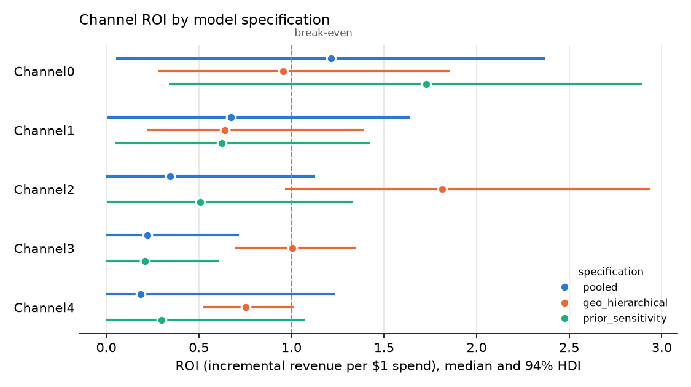

# Geo-level Bayesian MMM: Meridian simulated data

A Bayesian marketing mix model of Google Meridian's simulated geo dataset
([`geo_all_channels.csv`](https://github.com/google/meridian/blob/main/meridian/data/simulated_data/csv/geo_all_channels.csv)),
built with [PyMC-Marketing](https://github.com/pymc-labs/pymc-marketing) 1.3. It estimates channel contribution and ROI with
uncertainty. Automated pass/fail gates decide whether a fit is acceptable, so no one has to judge it by looking at plots.

## Verdict: is this good enough for a client?

**No. The automated verdict is FAIL** (82 pass, 18 warn, 1 fail; full evidence in
[`outputs/gate_report.md`](outputs/gate_report.md)).

**The primary model is technically sound.** `geo_hierarchical`:
- converges cleanly (R-hat ≤ 1.007, ESS ≥ 840, no divergences);
- has calibrated predictive intervals (94% interval covers 94.6% of observations);
- forecasts every held-out quarter in four rolling-origin folds without degrading (national weekly error 3.5–5.3%);
- gives ROI estimates that stay within 1.5× across those folds.

**It fails because its answer depends on a modeling assumption the data cannot settle.** Fitting the same data with
media effects shared across geos (`pooled`, `prior_sensitivity`) instead of partially pooled gives materially
different ROI:
- Channel2 ranges from 0.35 to 1.81, more than the 5× conflict threshold.
- Channel3 and Channel4 differ 4–5×.
- The channel rankings disagree.

The hierarchical model fits clearly better (ELPD ~180 higher), so it is the better-supported answer. But "is
Channel2 the best channel or one of the worst?" should not hinge on a pooling choice.

**What could be shared, as a caveated read and not as a budget recommendation:**
- **Channel1 returns less than it costs** under every specification (median ROI 0.62–0.67). This is the most
  robust finding.
- **Under the primary model:**
  - Channel4 is likely below break-even (P(ROI > 1) = 0.04).
  - Channel2 is likely above it (0.98).
  - Channel0 and Channel3, which together take 59% of spend, are undetermined around break-even.
- **Paid media drives about 16% of revenue.** That share is itself uncertain, because baseline and media trade off
  (posterior correlation −0.93).

**What would make it client-ready:** lift tests (geo holdouts) on Channel2 and Channel3, calibrated into the
model. Channel3 is the largest budget (40% of spend) and Channel2 is the largest disagreement. Experiments add
the information about baseline versus media that this data lacks.

## Reproduce

```bash
make setup     # fetch + checksum the data, create .venv from requirements.lock (needs uv)
make fit-all   # fit the three model specifications (~25-35 min each on an 8-core laptop)
make holdout   # refit the primary spec without the last 13 weeks and score the forecast
make cv        # rolling-origin CV folds for the primary spec (train to week 104/117/130, forecast 13)
make gates     # automated acceptance checks; exits 1 if any blocking check fails
make results   # outputs/channel_results.csv + metadata + ROI figure
```

Everything in `outputs/` is a deterministic function of `config/pipeline.yaml`, the checksummed data and
`requirements.lock`. MCMC is seeded (`random_seed: 20261027`).

## Data

- 40 geos × 156 weeks (2021-01-25 to 2024-01-15): a balanced panel with no missing values.
- 5 paid channels, each with spend and impressions. Spend is exactly impressions × a constant CPM per channel,
  so modeling spend loses no information.
- Controls: competitor sales, sentiment, promo and organic impressions.
- KPI: conversions. `revenue_per_conversion` is effectively constant (0.02, CV 0.5%), so revenue is
  conversions × 0.02.

## Modeling choices

| Choice | What and why |
|---|---|
| Target | Revenue (conversions × revenue_per_conversion), so ROI is incremental revenue per unit of spend. Cost per incremental conversion is reported too. |
| Model | `pymc_marketing.mmm.MMM` with `dims=("geo",)`: one model over all geos, never aggregated to a national series. |
| Media transform | Geometric adstock (`l_max` 8 weeks), then logistic saturation. |
| Scaling | PyMC-Marketing's default: channels and target are max-scaled **globally**, with one max across geos. |
| Baseline | One intercept per geo, yearly seasonality (2 Fourier pairs), and a linear time trend (revenue drifts up ~5% over 3 years). |
| Controls | Competitor sales and sentiment as given (already standardized); promo divided by its max; organic impressions divided by each geo's max. PyMC-Marketing passes controls into the model unscaled, so they are rescaled before fitting. Control and seasonality effects are pooled across geos. |
| Media effect size | Partially pooled across geos (primary spec): log β[channel, geo] = μ[channel] + τ·z[channel, geo], non-centered, with μ centered on a spend-share anchor (assumes media drives ~30% of revenue) and τ ~ HalfNormal(0.3). Shared across geos in the `pooled` robustness spec. |
| Media priors | In the pooled specs, effect size `HalfNormal` with sigma at 2× the same spend-share anchor. Adstock `Beta(1,3)`; saturation λ `Gamma(3,1)`. The priors are deliberately loose, and the ROI they imply on their own is reported next to the posterior so readers can see how far the data moved them. |
| Sampler | NUTS via numpyro: 4 chains × 1000 draws after 1000 tuning steps, `target_accept` 0.95. |
| ROI | `mmm.incrementality`: revenue with actual spend minus revenue with the channel switched off, including adstock carryover, divided by spend. Marginal ROI is the gain from +1% spend over that 1% of spend. |

### Three specifications

One model is not evidence that its answer is right, so the same data is fitted under alternative reasonable
assumptions and the results are checked for agreement.

| Spec | Media effect size | Other differences |
|---|---|---|
| `geo_hierarchical` (**primary**) | Partially pooled across geos | n/a |
| `pooled` | One value per channel, shared by all geos | n/a |
| `prior_sensitivity` | One value per channel, shared by all geos | Equal rather than spend-share effect priors, longer and slower-decaying adstock (`l_max` 12, `Beta(2,2)`), flatter saturation prior |

The final model is always fitted on the full dataset. The 13-week holdout refit is used only for validation.

### Why the pooled model was ruled out as primary

`pooled` was the original primary spec. It was replaced by `geo_hierarchical` (see [ITERATIONS.md](ITERATIONS.md),
entries 3–4) because:

- **It fits worse.** ELPD-LOO is ~180 lower and within-geo R² is half (0.064 vs 0.140). One media effect size for
  all 40 geos leaves geo-specific response in the residuals.
- **It misses the convergence standard.** Bulk ESS is 297 at 1000 draws (< 400). Its individual parameters mix
  well; the slow direction is total media against the 40 geo intercepts (r = −0.95). With shared effect sizes,
  more media requires every intercept to move down together: a long, narrow ridge through 45 coupled parameters.
  Partial pooling splits that into per-geo tradeoffs, and total media mixes with ESS 967.
- **Its ROI is unstable.** Dropping the last 13 weeks moves Ch0's median ROI from 1.21 to 0.66.
- **Partial pooling is the standard for geo MMMs.** It is the default in Google Meridian, which generated this
  dataset, and in PyMC Labs' `mmm-modeling` guidance.

**Caveats: what could have been done and wasn't.**
- Rerunning `pooled` at 2000 draws would likely have cleared the ESS threshold, but not the worse fit or the
  unstable ROI.
- An informative prior on the baseline share would ease the baseline–media ridge in both specs, but it needs an
  outside justification.
- The ~180-point ELPD gap has no formal standard error: pointwise log-likelihoods were not saved, so `az.compare`
  was not run.
- `pooled` stays in the pipeline as a robustness spec. Its ESS shortfall is reported as a non-blocking warning.

### How this compares with Google Meridian

Meridian, whose simulator produced this data, models geos with partially pooled (log-normal) media effects,
shared adstock and saturation shapes, priors placed directly on ROI, media and KPI scaled by geo population,
shared weekly time effects (knots) and per-geo control effects. The primary spec matches the first two. The
others are listed under next steps.

## Automated acceptance gates

`src/mmm/gates.py` reads each fit's `metrics.json` and marks every check PASS, WARN or FAIL. Any FAIL on the
primary spec makes `make gates` exit with code 1, so CI can refuse to publish the results. Thresholds live in
`config/pipeline.yaml`.

| Group | Check | Threshold | On failure |
|---|---|---|---|
| Data | Required columns, balanced weekly panel, no missing values, no negative spend or KPI | exact | FAIL |
| Priors | Share of observations inside the 94% prior predictive interval | 50–100% | FAIL |
| Convergence | R-hat max over all parameters | ≤ 1.01 | FAIL |
| | Bulk and tail ESS min | ≥ 400 | FAIL |
| | Divergences | 0 | FAIL |
| | E-BFMI min | ≥ 0.3 | FAIL |
| Fit | In-sample R² | ≥ 0.60 | FAIL |
| | 94% posterior predictive interval coverage | 85–99% | FAIL |
| | Within-geo R² (signal strength) | ≥ 0.20 | WARN |
| | Residual lag-1 autocorrelation (median across geos) | ≤ 0.30 | WARN |
| | PSIS-LOO share of observations with Pareto k > 0.7 | ≤ 1% | WARN |
| Holdout | Holdout geo-week MAPE ÷ in-sample MAPE | ≤ 1.25 | FAIL |
| | National weekly MAPE on the holdout | ≤ 10% | FAIL |
| | 94% interval coverage on the holdout | ≥ 80% | FAIL |
| ROI | Posterior SD of ROI much smaller than prior SD (contraction ≥ 0.3) | per channel | WARN |
| | P(ROI > 1) ≥ 0.9 or ≤ 0.1: clearly above or below break-even | per channel | WARN |
| Rolling-origin CV | Each fold (training on weeks 1–104, 1–117, 1–130, then forecasting the next 13): same three holdout checks | as holdout | FAIL |
| | Max ÷ min median ROI across the folds and the full fit | > 2 WARN, > 5 FAIL | FAIL |
| Robustness | Max ÷ min median ROI across specs | > 2 WARN, > 5 FAIL | FAIL |
| | Spearman agreement of channel ROI rankings between specs | ≥ 0.6 | WARN |

**One set of thresholds was changed after the data was examined, and this is why.** The first version gated
geo-week accuracy in absolute terms: in-sample MAPE ≤ 10%, within-geo R² ≥ 0.5 and holdout MAPE ≤ 15%. The raw
data shows that weekly revenue within a geo is close to white noise around the geo's level: coefficient of
variation 0.30, lag-1 autocorrelation 0.02, and |correlation| with spend ≤ 0.05. No model can reach those
thresholds, so they would not distinguish a good fit from a bad one. Accuracy is now judged against that noise
floor instead: the holdout must not be worse than in-sample, the national total (where geo noise averages out)
must be accurate, and the predictive intervals must be calibrated. Within-geo R² is reported as a signal-strength
warning.

## Results

Primary spec (`geo_hierarchical`), full period 2021-01-25 to 2024-01-15. ROI is incremental revenue per unit of
spend. Full detail is in [`outputs/channel_results.csv`](outputs/channel_results.csv).

| Channel | Spend share | ROI median (94% HDI) | P(ROI > 1) | Marginal ROI | Share of revenue | ROI range across CV folds | ROI range across specs | Gate |
|---|---|---|---|---|---|---|---|---|
| Channel0 | 18.5% | 0.95 (0.28–1.86) | 0.47 | 0.88 | 3.1% | 0.76–1.16 | 0.95–1.73 | WARN |
| Channel1 | 14.3% | 0.64 (0.22–1.39) | 0.20 | 0.61 | 1.7% | 0.56–0.70 | 0.62–0.67 | WARN |
| Channel2 | 5.5% | 1.81 (0.97–2.94) | 0.98 | 1.66 | 1.7% | 1.38–2.07 | 0.35–1.81 | **FAIL** |
| Channel3 | 40.0% | 1.00 (0.69–1.35) | 0.51 | 0.89 | 6.8% | 1.05–1.10 | 0.21–1.00 | WARN |
| Channel4 | 21.7% | 0.75 (0.52–1.02) | 0.04 | 0.71 | 2.7% | 0.71–0.82 | 0.18–0.75 | WARN |



- **Media effects are short-lived.** Adstock half-lives are 0.2–1.2 weeks.
- **Marginal ROI sits slightly below average ROI for every channel,** so the model sees mild diminishing returns
  at current spend.
- **The CV ROI range for a channel need not include its full-period median.** Each fold estimates ROI over its own
  training window, so differences across folds mix real changes in the spend mix with model instability.

### `channel_results.csv` columns

| Column(s) | Meaning |
|---|---|
| `roi_median`, `roi_hdi94_low/high`, `roi_hdi80_low/high`, `roi_mean`, `roi_sd` | Total incremental revenue ÷ total spend over the period |
| `prob_roi_gt_1` | Posterior probability that the channel returns more revenue than it costs |
| `mroi_*` | Marginal ROI: incremental revenue from the next 1% of spend ÷ that 1% |
| `contribution_*` | Incremental revenue attributed to the channel; also as a share of total revenue |
| `cost_per_incremental_conversion_median` | Spend ÷ median incremental conversions |
| `roi_prior_*`, `roi_prior_contraction` | ROI implied by the priors alone, and how much the data narrowed it (1 − posterior SD ÷ prior SD) |
| `roi_median_min/max_across_specs` | Range of the median ROI across the three specifications |
| `adstock_alpha_median`, `adstock_half_life_weeks_median`, `saturation_lam_median` | Media dynamics |
| `channel_gate_status`, `model_gate_verdict` | Worst gate status among this channel's checks, and the overall verdict |
| `spend`, `spend_share`, `period_start/end`, `model_spec` | Context for downstream use |

`outputs/channel_results_metadata.json` holds the column definitions, the model spec, the sampler settings,
fit and convergence summaries, and package versions.

## What the data can't support

- **Weak signal at the geo-week level.** Weekly revenue within a geo varies ±30% with no persistence, and spend
  explains almost none of that movement. Most of what identifies media effects comes from differences between
  geos and from aggregation, so channel ROIs will be wide.
- **Baseline and media are hard to separate.** With no experiments, the model cannot pin down how much of the
  revenue level is baseline and how much is media. Total media contribution and the summed geo intercepts are
  correlated at −0.93 in the primary posterior (−0.95 in `pooled`). The 16% media share should be read as
  uncertain, not as a point fact.
- **Channel ROI depends on the pooling assumption.** Partial pooling fits better, but the data cannot rule out
  the shared-effect specifications, and they rank the channels differently. This is the reason for the FAIL
  verdict.
- **Even the best model explains little week-to-week movement.** The primary model explains 14% of within-geo
  weekly variation; the rest looks like noise.
- **Correlated channels.** National weekly spend is correlated across channels (r up to 0.64), which limits the
  ability to tell channels apart.
- **Channel2 is often dark.** It has zero spend in 64% of geo-weeks, so its response curve is estimated from
  little variation.
- **Reach and frequency are not separable.** Impressions are exactly spend ÷ CPM, so the data offers no
  independent exposure measure.
- **No ground truth in the CSV.** The data is simulated, but the true ROIs are not published alongside it, so
  parameters cannot be checked for recovery here.

## Next steps

- **Calibrate with lift tests** (`mmm.add_lift_test_measurements`). This is the most direct fix for weak
  identification between baseline and media.
- **More CV folds and CRPS scoring.** The primary spec has four 13-week rolling-origin folds. Shorter steps
  (pymc-marketing's `TimeSliceCrossValidator`) and CRPS would give a finer view of stability.
- **Per-geo control and seasonality effects.** Under global scaling, pooled coefficients force the same absolute
  effect on a small geo as on a large one (7× size range), a mild misspecification. The fix is PyMC-Marketing's
  default `dims=("geo", "control")` / `("geo", "fourier_mode")`. Per-geo scaling as a robustness spec is an
  alternative.
- **Effect-size priors in the intended units.** The spend-share anchor was calibrated for per-geo scaling, so
  under the global scaling actually used, the prior is about 1.9× wider than described above. It is still weakly
  informative (the prior-implied ROI is reported), but it should be recalibrated.
- **Score holdout forecasts with CRPS,** which evaluates the whole predictive distribution, not just its mean.
- **Meridian-style structure:** scale media and KPI by geo population, add shared weekly time effects to absorb
  national shocks, and put priors directly on ROI.
- **Save pointwise log-likelihoods and compare specs with `az.compare`,** so the ELPD gap between specs has a
  standard error.
- **More draws if ESS fails,** before any change to `target_accept`.
- **Budget optimization** (`BudgetOptimizerWrapper`), but only once ROI intervals pass the break-even gate.
  Optimizing on undetermined ROIs would present noise as a recommendation.

## Repository layout

Every model run and the modeling decisions that followed are logged in [ITERATIONS.md](ITERATIONS.md).

```
config/pipeline.yaml     data mapping, model specs, sampler, gate thresholds
src/mmm/data.py          load, validate, shape the panel
src/mmm/model.py         build a PyMC-Marketing MMM from a spec
src/mmm/run_spec.py      fit one spec; diagnostics, fit, holdout, ROI -> outputs/specs/<spec>/
src/mmm/gates.py         automated acceptance -> outputs/gate_report.{json,md}
src/mmm/results.py       client-facing channel results file + figure
scripts/fetch_data.sh    download + checksum the dataset
outputs/                 committed results; artifacts/ (posterior draws) is git-ignored
ITERATIONS.md            log of model runs, results and modeling decisions
```
