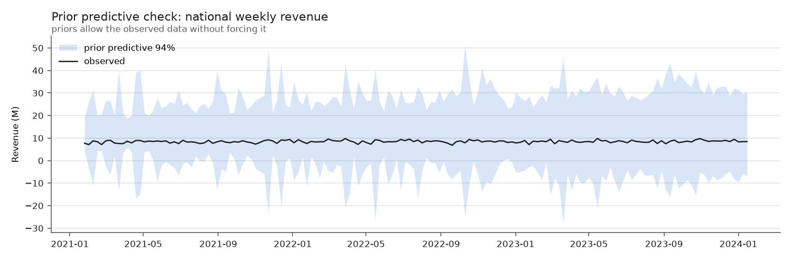
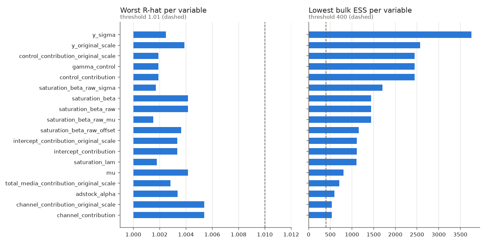
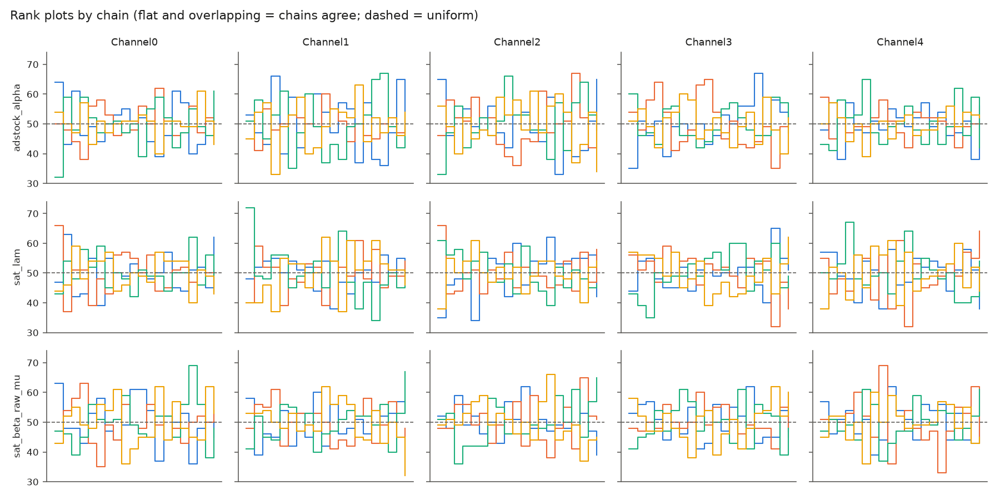
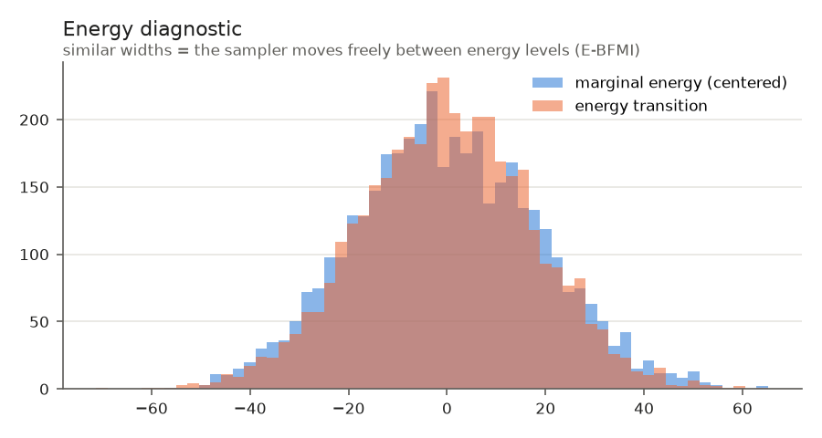
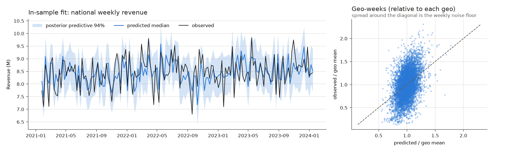
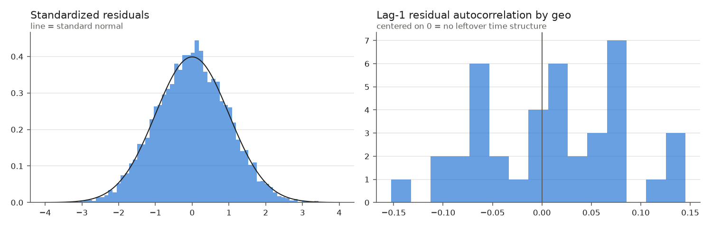
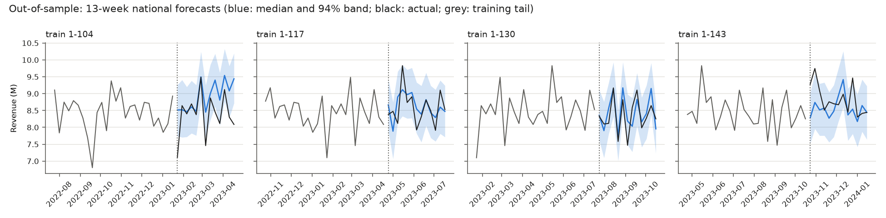
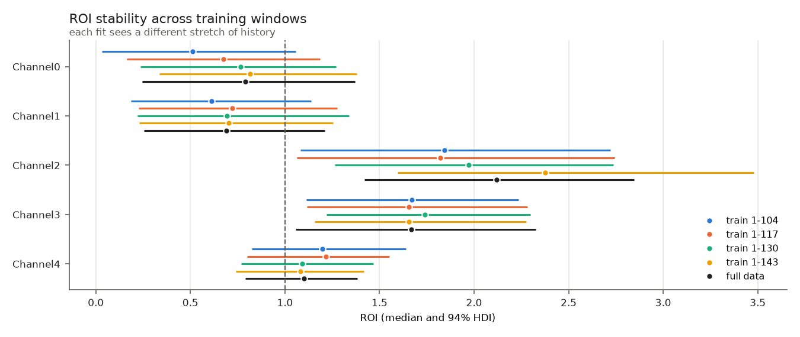
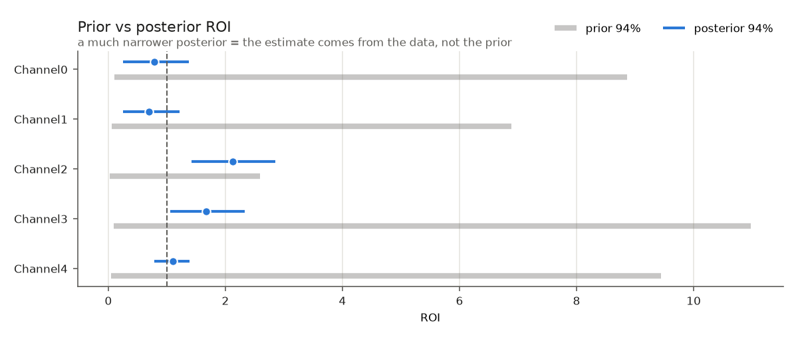
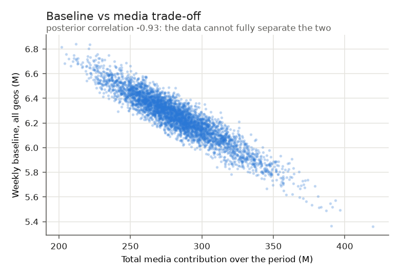

# Model health report: `hier_media`

**Gate verdict: PASS_WITH_WARNINGS** (41 pass, 4 warn, 0 fail). This report shows
the evidence behind each check. Every figure is regenerated by `make reports`.

## 1. How this model was chosen

Rule: simplest candidate within 2 SE of the best ELPD (non-converged candidates excluded).

| Candidate | Status | ELPD-LOO (SE) | ELPD difference from best (SE) | Within 2 SE |
|---|---|---|---|---|
| `pooled_media` | not converged | n/a | n/a | n/a |
| `hier_media` | converged | 4070.7 (55.1) | -0.0 (0.0) | yes |
| `hier_media_controls` | not converged | n/a | n/a | n/a |

**Highest ELPD:** `hier_media`. **Selected:** `hier_media`.

The other candidates failed their convergence checks and were stopped without results.

## 2. Data checks

| Status | Check | Value | Threshold |
|---|---|---|---|
| PASS | data: required columns present | [] |  |
| PASS | data: balanced weekly panel, no missing values | {'balanced_panel': True, 'weekly_contiguous': True, 'n_missing_values': 0} |  |
| PASS | data: no negative spend or KPI | 0 |  |

## 3. Priors

| Status | Check | Value | Threshold |
|---|---|---|---|
| PASS | prior predictive coverage | 1.0 | [0.5, 1.0] |

The prior predictive band covers the observed series without being pinned to it. Coverage of 100% means the
priors are permissive; the posterior, not the prior, determines the estimates (section 7).

## 4. Sampling convergence

4 chains × 1000 draws after 1000 tuning steps, `target_accept` 0.95, NUTS via numpyro.

| R-hat max | ESS bulk min | ESS tail min | Divergences | E-BFMI min |
|---|---|---|---|---|
| 1.0054 | 532 | 896 | 0 | 0.85 |

All variables are below the R-hat threshold and above the ESS threshold. Rank plots are flat and overlap across
chains, and the energy distributions match, so the chains explored the same posterior.

## 5. In-sample fit

| R² | Within-geo R² | MAPE (geo-week) | 94% interval coverage | Median \|lag-1 residual ACF\| | Pareto k > 0.7 |
|---|---|---|---|---|---|
| 0.729 | 0.156 | 0.295 | 0.948 | 0.060 | 0.0% |

The predictive intervals are calibrated (94% interval covers 94.8% of geo-weeks) and
residuals show no leftover time structure. Geo-week error is high (MAPE 30%) because weekly revenue
within a geo is close to white noise (EDA: CV 0.30, lag-1 autocorrelation 0.02); the model explains
16% of within-geo weekly variation. The national total, where geo noise averages out, is
tracked closely.

## 6. Out-of-sample: holdout and rolling-origin CV

Each fold trains on weeks 1..N with the selected specification (scaling and priors recomputed from that window
only) and forecasts the next 13 weeks without seeing them. The four forecast windows cover the last year.

**Findings**

- 4 of 4 folds converged (R-hat ≤ 1.0065, bulk ESS ≥ 641, 0 divergences in total).
- Forecast error vs in-sample error: ratio 1.03–1.11 (gate ≤ 1.25): forecasts are no worse than the in-sample fit.
- National weekly forecast error 3.5%–7.0% (gate ≤ 10%); 94% interval coverage 91%–95% (gate ≥ 80%).
- ROI stability across the four training windows and the full fit: max ÷ min median ROI is Channel0 1.59×, Channel1 1.18×, Channel2 1.30×, Channel3 1.05×, Channel4 1.12× (warn above 2.0×). Most variable: Channel0.

| Fold (train weeks) | Status | R-hat max | ESS bulk min | Divergences | Geo-week MAPE in-sample → forecast | National weekly MAPE | Geo-week 94% coverage |
|---|---|---|---|---|---|---|---|
| 1-104 | converged | 1.0051 | 1297 | 0 | 0.293 → 0.314 | 7.0% | 94% |
| 1-117 | converged | 1.0047 | 641 | 0 | 0.293 → 0.301 | 4.0% | 94% |
| 1-130 | converged | 1.0065 | 929 | 0 | 0.292 → 0.325 | 3.5% | 95% |
| 1-143 (holdout) | converged | 1.0048 | 972 | 0 | 0.293 → 0.309 | 4.6% | 91% |

| Median ROI | 1-104 | 1-117 | 1-130 | 1-143 (holdout) | full data |
|---|---|---|---|---|---|
| Channel0 | 0.51 | 0.67 | 0.76 | 0.82 | 0.79 |
| Channel1 | 0.61 | 0.72 | 0.69 | 0.70 | 0.69 |
| Channel2 | 1.84 | 1.82 | 1.97 | 2.37 | 2.12 |
| Channel3 | 1.67 | 1.65 | 1.74 | 1.65 | 1.67 |
| Channel4 | 1.20 | 1.22 | 1.09 | 1.08 | 1.10 |

The plot below re-scores each fold's **national** forecast from its saved posterior (every 4th draw):

| Fold | National weekly MAPE | National 94% interval coverage |
|---|---|---|
| train 1-104 | 6.9% | 69% |
| train 1-117 | 4.0% | 92% |
| train 1-130 | 3.6% | 92% |
| train 1-143 | 4.6% | 77% |

**National-level calibration.** Geo-week intervals are calibrated. At the national level the 94% interval covers
91% of weeks in-sample, but 69%–92% out-of-sample
(each fold has only 13 weeks, so a single fold's coverage is uncertain by about ±7 points). Residuals are not
correlated across geos (average pairwise correlation +0.01), so this is not shared weekly noise.
The shortfall comes from level errors in some forecast windows (national forecast bias by fold: train 1-104 +6.5%, train 1-117 +0.7%, train 1-130 +1.2%, train 1-143 -2.8%): the intervals do not include uncertainty
about the baseline level moving between the training and forecast periods. National forecasts should therefore
be read with wider uncertainty than shown.

### hier_media (time holdout)

| Status | Check | Value | Threshold |
|---|---|---|---|
| PASS | holdout geo-week MAPE vs in-sample (no degradation) | 1.054 | 1.25 |
| PASS | holdout national weekly MAPE | 0.0455 | 0.1 |
| PASS | holdout 94% interval coverage | 0.91 | 0.8 |
| PASS | holdout fit converged (R-hat) | 1.0048 | 1.01 |

### hier_media (rolling-origin CV)

| Status | Check | Value | Threshold |
|---|---|---|---|
| PASS | train 1-104: geo-week MAPE vs in-sample (no degradation) | 1.069 | 1.25 |
| PASS | train 1-104: national weekly MAPE | 0.0699 | 0.1 |
| PASS | train 1-104: 94% interval coverage | 0.938 | 0.8 |
| PASS | train 1-104: fit converged (R-hat) | 1.0051 | 1.01 |
| PASS | train 1-117: geo-week MAPE vs in-sample (no degradation) | 1.029 | 1.25 |
| PASS | train 1-117: national weekly MAPE | 0.0403 | 0.1 |
| PASS | train 1-117: 94% interval coverage | 0.94 | 0.8 |
| PASS | train 1-117: fit converged (R-hat) | 1.0047 | 1.01 |
| PASS | train 1-130: geo-week MAPE vs in-sample (no degradation) | 1.112 | 1.25 |
| PASS | train 1-130: national weekly MAPE | 0.0353 | 0.1 |
| PASS | train 1-130: 94% interval coverage | 0.952 | 0.8 |
| PASS | train 1-130: fit converged (R-hat) | 1.0065 | 1.01 |
| PASS | ROI stable across CV folds: Channel0 | 1.59 | [2.0, 5.0] |
| PASS | ROI stable across CV folds: Channel1 | 1.18 | [2.0, 5.0] |
| PASS | ROI stable across CV folds: Channel2 | 1.3 | [2.0, 5.0] |
| PASS | ROI stable across CV folds: Channel3 | 1.05 | [2.0, 5.0] |
| PASS | ROI stable across CV folds: Channel4 | 1.12 | [2.0, 5.0] |

## 7. Identification: is ROI learned from the data?

| Channel | Prior ROI 94% | Posterior ROI 94% | Contraction | P(ROI > 1) |
|---|---|---|---|---|
| Channel0 | 0.11–8.86 | 0.25–1.37 | 0.93 | 0.25 |
| Channel1 | 0.06–6.89 | 0.25–1.21 | 0.93 | 0.14 |
| Channel2 | 0.02–2.59 | 1.42–2.85 | 0.70 | 1.00 |
| Channel3 | 0.09–10.98 | 1.06–2.32 | 0.93 | 0.99 |
| Channel4 | 0.05–9.44 | 0.79–1.38 | 0.96 | 0.71 |

Posterior ROI intervals are much narrower than the prior's, so the data drives the estimates. The baseline and
total media contribution trade off (posterior correlation -0.93): the data pins down the sum better than the
split, which is the main reason to calibrate with lift tests.

## 8. Known limitations of this model

- **Control effects are shared across geos.** The EDA shows competitor sales and sentiment effects vary by geo
  (I² 0.94 and 0.88), and both correlate with spend, so some geo-specific control effect can leak into media ROI.
- **Weak weekly signal.** Within-geo R² is 0.16; channel ROIs rest mostly on spend timing
  differences, which are noisy.
- **Saturation is weakly identified.** The top of each response curve is rarely observed, so marginal ROI and
  any large reallocation lean on the prior shape.
