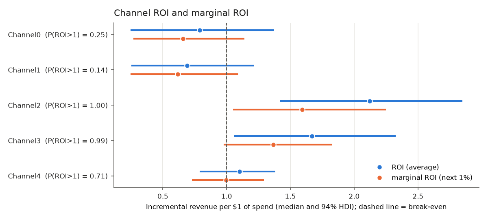
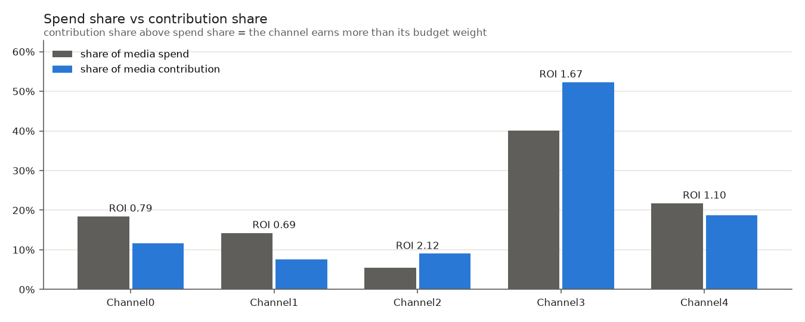
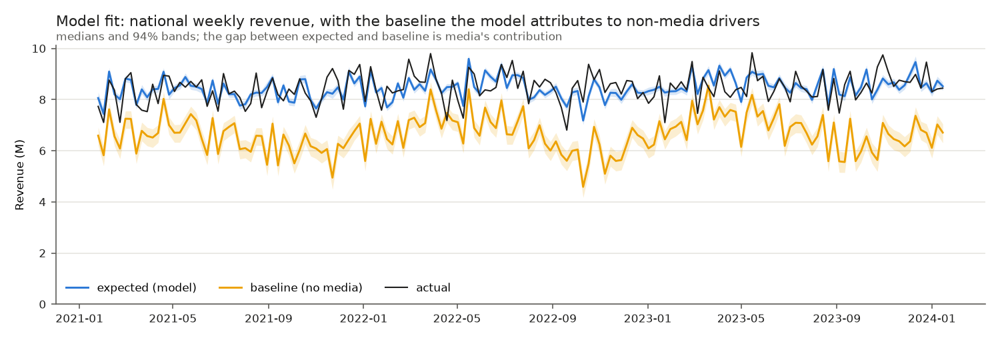
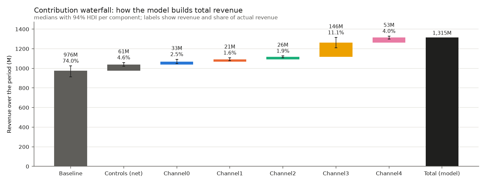
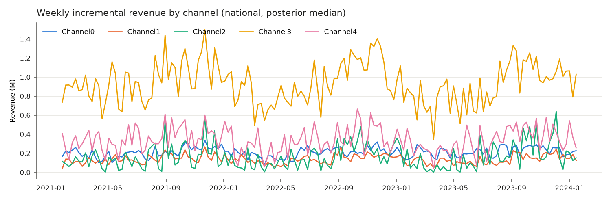
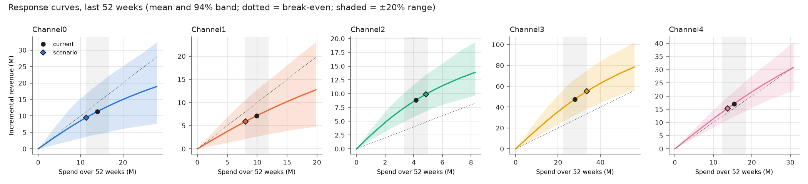
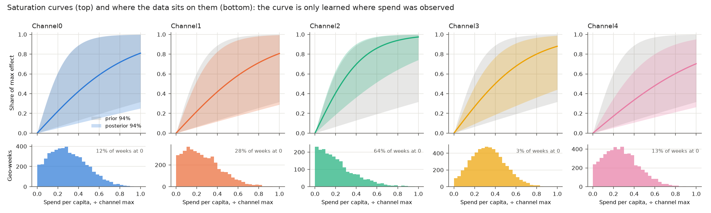
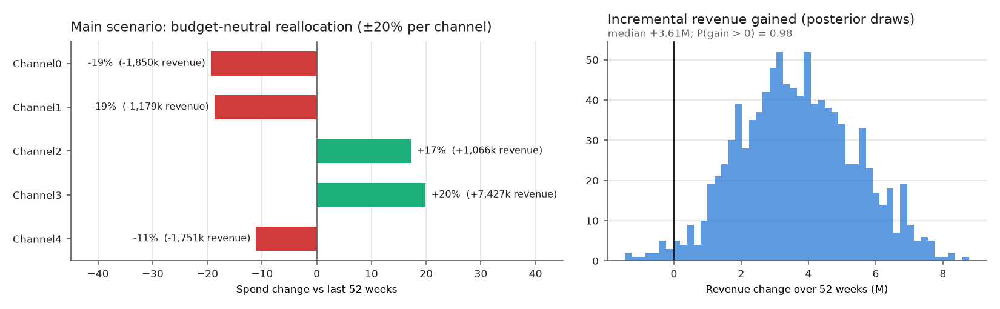

# Measurement report: `hier_media`

Model health: **PASS_WITH_WARNINGS** (see [diagnostics.md](diagnostics.md)). Period 2021-01-25 to
2024-01-15, 40 geos. ROI is incremental revenue per unit of spend: revenue with actual spend minus
revenue with the channel switched off, including adstock carryover, divided by spend.

## 1. Channel results

Machine-readable: [`outputs/channel_results.csv`](../outputs/channel_results.csv) (one row per channel; column
definitions in [`outputs/channel_results_metadata.json`](../outputs/channel_results_metadata.json)).

| Channel | Spend share | ROI median (94% HDI) | P(ROI > 1) | Marginal ROI | Incremental revenue (94% HDI) | Share of revenue | ROI range across CV folds | Gate |
|---|---|---|---|---|---|---|---|---|
| Channel0 | 18.5% | 0.79 (0.25–1.37) | 0.25 | 0.66 | 32.00M (9.98M–55.52M) | 2.5% | 0.51–0.82 | WARN |
| Channel1 | 14.3% | 0.69 (0.25–1.21) | 0.14 | 0.62 | 21.60M (7.96M–37.94M) | 1.7% | 0.61–0.72 | WARN |
| Channel2 | 5.5% | 2.12 (1.42–2.85) | 1.00 | 1.59 | 25.62M (17.16M–34.39M) | 2.0% | 1.82–2.37 | PASS |
| Channel3 | 40.0% | 1.67 (1.06–2.32) | 0.99 | 1.37 | 146.60M (92.83M–204.27M) | 11.3% | 1.65–1.74 | PASS |
| Channel4 | 21.7% | 1.10 (0.79–1.38) | 0.71 | 1.00 | 52.56M (37.72M–65.97M) | 4.0% | 1.08–1.22 | WARN |

Paid media drives 21.3% of revenue (posterior median). Marginal ROI below average ROI
means diminishing returns: the next dollar earns less than the average dollar so far.

## 2. Where revenue comes from

Baseline is revenue the model attributes to non-media drivers (geo intercepts); controls are competitor sales,
sentiment, promo, organic impressions and trend. Baseline and media trade off in the posterior (correlation
about −0.9; see diagnostics), so channel rankings are firmer than the absolute split.

## 3. Response curves

Saturation curves (top row, normalized to each channel's maximum effect) show how quickly returns diminish; the
histograms below show where the data actually sits. Where there is little data, the curve follows the prior
(grey band), so spend levels beyond the observed range are an extrapolation.

How much the data narrowed each curve's shape (posterior ÷ prior 94% width of the saturation rate λ; 1.0 = learned
nothing): Channel0 1.03, Channel1 0.82, Channel2 0.86, Channel3 0.64, Channel4 0.49. Channels near 1.0 have curve
shapes set mostly by the prior, so their marginal ROI and the reallocation scenario rest more on assumptions than on
data for those channels.

Each response curve shows incremental revenue over the last 52 weeks if that channel's spend were scaled up or down,
keeping its geo split and weekly timing. The flatter the curve at the current point, the less the next dollar
earns. Bands widen away from current spend because the data rarely observed those levels.

## 4. Budget reallocation scenario

**Question:** with the same total budget as the last 52 weeks (71.44M), how should spend be split
across channels? Each channel's spend is scaled by a multiplier, keeping its geo split and timing; total spend
is held fixed. The multipliers maximize expected incremental revenue on the posterior-mean response curves, and
the gain is then evaluated on 1000 posterior draws.

| Scenario | Spend multipliers | Revenue gain over 52 weeks, median (94% HDI) | % of revenue | P(gain > 0) |
|---|---|---|---|---|
| main (±20% per channel) | Channel0 0.81×, Channel1 0.81×, Channel2 1.17×, Channel3 1.20×, Channel4 0.89× | +3.61M (+0.78 to +7.07) | +0.81% | 0.98 |
| stress (±50% per channel) | Channel0 0.51×, Channel1 0.51×, Channel2 1.48×, Channel3 1.50×, Channel4 0.73× | +7.18M (-0.15 to +16.04) | +1.62% | 0.96 |

Main scenario detail ([`outputs/budget_scenario.csv`](../outputs/budget_scenario.csv)):

| Channel | Current spend | Scenario spend | Change | Marginal ROI at current spend | Revenue change (median) |
|---|---|---|---|---|---|
| Channel0 | 14.00M | 11.28M | -19% | 0.67 | -1,850k |
| Channel1 | 9.91M | 8.05M | -19% | 0.65 | -1,179k |
| Channel2 | 4.14M | 4.86M | +17% | 1.61 | +1,066k |
| Channel3 | 27.98M | 33.56M | +20% | 1.41 | +7,427k |
| Channel4 | 15.41M | 13.69M | -11% | 1.01 | -1,751k |

**How to read this.** Money moves from channels with low marginal ROI to channels with high marginal ROI until
the limit (±20%) binds. The ±20% range stays close to spend levels the data has seen. The ±50% stress
scenario extrapolates further along the curves, where the saturation shape rests more on the prior; treat it
as an upper bound, not a plan.

## 5. Caveats for using these numbers

- **Undetermined channels.** Channels whose P(ROI > 1) is between 0.1 and 0.9 cannot be called profitable or
  unprofitable; their gate status is WARN.
- **Shared control effects.** The model assumes competitor and sentiment effects are the same in every geo,
  although the data says they differ (I² 0.94, 0.88). Both correlate with spend, so some of their geo-specific
  effect may be attributed to media.
- **Baseline vs media.** The data pins down total revenue better than its split between baseline and media;
  absolute contributions are less certain than channel rankings.
- **Scenario, not forecast.** The reallocation replays last year's conditions. It assumes the response curves
  hold and that competitors and other drivers do not react.
- **Validation.** Lift tests (geo holdouts) on the largest budgets would calibrate these curves and are the most
  direct way to firm up the recommendations.
